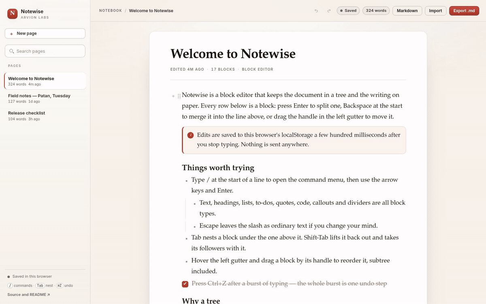
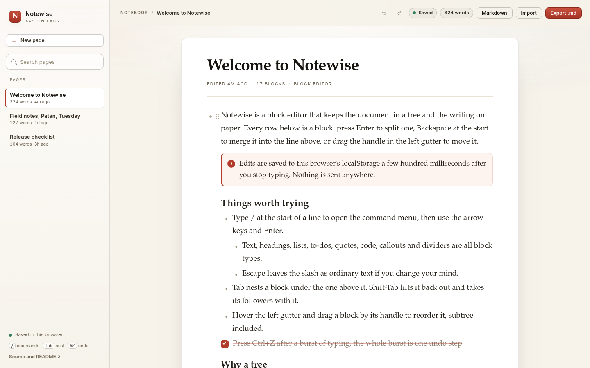
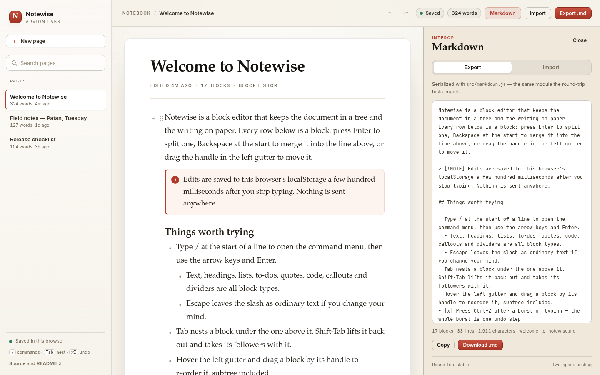

<div align="center">

</div>

<sub>Recorded from the live demo — <a href="docs/demo.mp4">MP4</a> · <a href="docs/screenshot.png">static frame</a></sub>

# Notewise

A block editor for the browser: slash commands, nested blocks, drag handles, an
undo stack that collapses a typing burst, and Markdown that survives a
round-trip. No dependencies, no build step, no network calls after the page
loads.

[**Open the live demo**](https://arvion-technology.github.io/labs/demos/notewise/) · [CI](https://github.com/arvion-technology/notewise/actions/workflows/ci.yml) · [MIT](LICENSE)

---

Most contenteditable editors start by writing HTML and then spend the rest of
their life working backwards from it: nesting is inferred from list markup, list
numbers are the browser's idea of order, and every edit has to decide which DOM
nodes to repair. Notewise takes the other route. A page is a tree of blocks, the
tree is the only source of truth, and the DOM is thrown away and rebuilt after
each structural edit. That makes insert, split, merge, indent and move ordinary
functions with ordinary tests.

The demo seeds three pages, saves them to localStorage, and imports and exports
the same Markdown the test suite round-trips.

## What it does

- Eleven block types: paragraph, three heading levels, bulleted, numbered and
  to-do items, quotes, fenced code, callouts and dividers.
- A slash menu that filters as you type and works from the keyboard: `/` opens
  it, arrow keys move, Enter applies, Escape leaves the slash as text.
- Drag handles in the left gutter for reordering, and Tab / Shift-Tab for
  nesting. Depth guides make the hierarchy visible.
- Undo and redo over whole documents. Keystrokes in one block coalesce inside a
  900 ms window, so one Ctrl+Z removes a sentence instead of a letter.
- Markdown export and import. Headings, nested lists, to-dos, quotes, callouts,
  fenced code and dividers all round-trip; list numbering is rebuilt from the
  tree, not copied from the source.
- Local persistence with a versioned payload and per-block sanitisation, live
  word count, reading time, and page search that reaches into nested blocks.
- A second demonstration view at `#markdown` that shows the serialized source
  next to the writing surface.

## Screenshots

| Writing surface | Markdown panel |
| --- | --- |
|  |  |

## Architecture

```text
browser
├── demo/
│   ├── index.html        paper-theme shell, sidebar, editor canvas
│   ├── app.js            rendering, caret mapping, keyboard and drag wiring
│   ├── seed.js           three seeded pages
│   ├── styles.css        editor-specific styles on top of arvion.css
│   └── arvion.css/.js    shared Arvion design system (not edited)
│
├── src/
│   ├── blocks.js         block tree: locate, insert, split, merge, move, indent
│   ├── markdown.js       serializer and parser for the same tree
│   ├── history.js        snapshot undo with time-based coalescence
│   ├── text.js           word count, reading time, nested block search
│   └── storage.js        versioned localStorage payload and sanitisation
│
└── test/                 62 node:test cases
```

The demo imports `../src/*.js` directly. There is no duplicated tree logic in
the browser layer, and no build artifact to keep in sync.

**Data model.** A page is `{ id, title, doc }` and a document is a tree:

```js
{
  id: "b-7",
  type: "bulleted",
  text: "The bronze workshop opens at nine",
  children: [
    { id: "b-8", type: "paragraph", text: "The sign is wrong.", children: [] }
  ]
}
```

The renderer flattens that depth-first into rows with a `depth` and a marker.
Everything else — list numbers, indentation guides, keyboard navigation — is
derived from the tree at render time.

## Quickstart

```bash
git clone https://github.com/arvion-technology/notewise.git
cd notewise
npm test          # 62 tests, Node 20 or newer, nothing to install
npm run demo      # http://localhost:4173
```

`package.json` exists so `npm test` and the CI workflow have a standard entry
point; there are no runtime dependencies. To capture the screenshots again:

```bash
npm run shot
npm run shot:2
```

## How it works

**Splitting and merging happen on the tree, not the DOM.** Pressing Enter calls
`splitBlock(doc, id, offset)`. The text after the caret becomes a new sibling of
the same type, and the original block's children move to the new block — the
same rule Notion uses when you split a parent line. Backspace at offset zero
calls `mergeWithPrevious`, which appends the text to the previous sibling and
adopts its children, or, when there is no previous sibling, lifts the block out
one level instead.

```js
import { splitBlock } from "../src/blocks.js";

// Split at the caret; children stay with the tail
const { block, caret } = splitBlock(doc, "b-7", 12);
```

Dedent is the interesting one. When a block is lifted out of its parent, the
siblings that followed it become its children, so text does not jump across the
page. `moveBlock` refuses to drop a block inside its own subtree, which is the
one move that would detach part of the document from the root.

**Undo stores whole documents, then coalesces the ones that should not count.**
A page is small enough that cloning it is cheaper than maintaining inverse
operations. Each push carries a label and an optional coalescing key; repeated
pushes with `key: "text:b-7"` inside 900 ms replace the head of the stack rather
than appending to it:

```js
history.push(doc, { key: "text:b-7", label: "Typing" });   // one step
history.push(doc, { key: "text:b-7", label: "Typing" });   // still one step
history.push(doc, { label: "Indent block" });              // a new step
```

The window is injected in tests, so the boundary is asserted without sleeping.
Structural edits never carry a key, and switching blocks or pages breaks the
burst.

**Markdown is a projection with its own rules.** The serializer emits one line
per block, children indented two spaces, and a blank line between root blocks
unless both are list items. A numbered run is numbered from its position among
numbered siblings, so `1.`, `2.` in the source may come back as `1.`, `2.`
regardless of what the file said. Leading markers inside paragraph text are
backslash-escaped (`\# not a heading`), code fences grow when the code contains
backticks, and empty paragraphs are omitted. The parser rebuilds the tree with
an indentation stack and clamps jumps in indentation to the nearest open parent
instead of losing text.

```markdown
- First
  - Nested
- [x] Done

> [!NOTE] This comes back as a callout block
```

Round-trip tests compare the full block shape (type, text, checked, language,
children) after `toMarkdown` and `parseMarkdown`, then compare the exported text
again so a second export is byte-identical.

**Persistence is one JSON blob with a version and a sanitiser.** On load, every
block is rebuilt from known fields, unknown types fall back to paragraphs, depth
and block count are capped, and duplicate page ids are repaired. A corrupt or
blocked `localStorage` falls back to the seeded pages rather than an empty
editor; the sidebar says "Session only" when storage is unavailable.

## Tests

```bash
npm test
```

62 tests on `node:test` cover the tree operations (split children, merge caret
positions, indent under the previous sibling, dedent with trailing siblings,
rejecting a move into a block's own subtree), Markdown serialization and parsing
of every block type, escaped leading markers, fence growth, empty items and
round-trip stability, undo semantics including coalescence, window expiry,
branch truncation and limits, plus word counting, nested search, payload
sanitisation and corrupt-storage recovery.

The demo has a separate static check for asset references, theme wiring and
placeholder text:

```bash
node scripts/serve-check.mjs
```

## Limitations

Inline emphasis is not rendered. `**bold**` stays as literal characters in the
block and is exported unchanged; making it rich would require a second inline
mark model with its own ranges, caret mapping and undo behaviour, which is a
different project. The Markdown panel is where the text is intended to be read
as source.

Beyond that: the page title lives beside the document rather than inside it, so
export covers the body, and importing a file that starts with `# Heading`
creates a heading block. Import treats each non-empty line as one block, so a
hard-wrapped paragraph from another editor becomes several paragraphs. There is
no collaboration, no sync and no conflict resolution — one page, one browser.

## Project layout

```text
notewise/
├── demo/               # static app (no build step)
│   ├── index.html
│   ├── app.js          # DOM projection, caret, keys, slash menu, drag
│   ├── seed.js         # three seeded pages
│   ├── styles.css      # paper-theme editor chrome
│   ├── arvion.css/.js  # shared Arvion design system
│   └── fonts/          # self-hosted Inter + Poppins
├── src/
│   ├── blocks.js       # block tree operations
│   ├── markdown.js     # serializer + parser
│   ├── history.js      # snapshot undo with coalescing
│   ├── text.js         # word count, stats, search
│   └── storage.js      # versioned localStorage payload
├── test/               # 62 node:test cases
├── scripts/            # serve, screenshot, static checks
└── .github/workflows/  # CI: tests on Node 20 and 22
```

## Credits

Built by [Arvion Technologies](https://arviontech.net) in Kathmandu as part of
the [Arvion Labs](https://github.com/arvion-technology/labs) open-source series.
MIT licensed.
